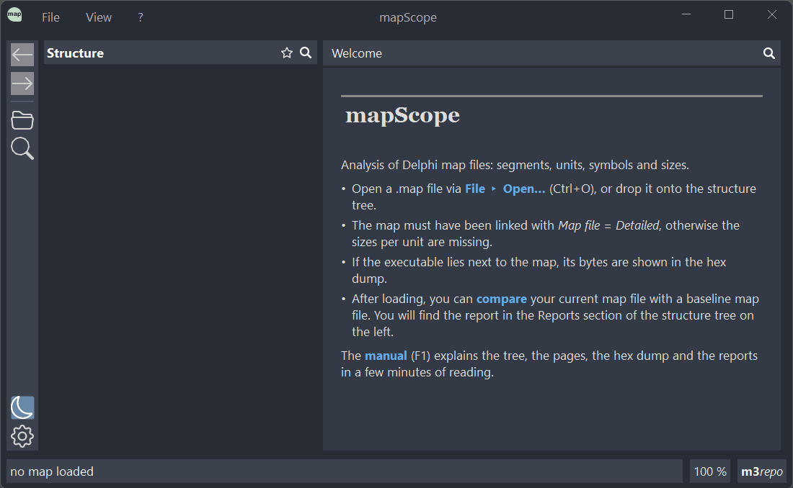

# mapScope

**See what is inside your Delphi executable.**

<!-- Animierter Screenshot (GIF, ~20 s, Schleife): Map öffnen, Baum, Unit wählen -> Hexdump, Generics-Report, Doppelklick im Hexdump -->

mapScope reads the detailed `.map` file that the Delphi linker writes next to your EXE, DLL or BPL and shows where the bytes go: segments, units, classes, methods, resources — with sizes, charts and a hex dump of the actual executable. **Includes an in-depth analysis of generics and RTTI**.

> **Public beta.** mapScope is free to use. Features may still change; feedback and bug reports are welcome (see [Issues](../../issues)). It has been tested with map files from Delphi 12. If something looks wrong with another Delphi version, please open an issue and attach the .map and EXE of a small demo project as a ZIP file.

## What it does

- **Structure tree** — segments → unit contributions → symbols, units → classes and methods, resources by type, plus reports.
- **Pages with numbers and charts** — overview, every segment, unit, symbol and resource has its own page with sizes and links.
- **Hex dump of the real executable** — select a unit or symbol and its bytes are highlighted; click a byte to see which symbol it belongs to.
- **Binary search** — find text, numbers and byte sequences in the executable.
- **Resources** — preview images and icons, read string tables.
- **Reports** — what generics cost you, how much type information (VMT/RTTI) is in your binary.
- **Before/after comparison** — keep a baseline, rebuild, and see which units grew or shrank.

## Download

**[Download from Releases](../../releases)** — during the beta, releases are marked as pre-release. mapScope is portable: a signed EXE in a ZIP file — no installer, no setup. Unzip and run.

## Quick start

1. In Delphi, open **Project → Options → Building → Delphi Compiler → Linking** and set **Map file** to **Detailed**. Build your project.
2. Start mapScope and open the `.map` file (**File → Open**, Ctrl+O), or drag the `.map` — or the EXE itself — onto the window.
3. Browse the tree on the left. Keep the EXE next to the `.map` to get the hex dump.

The [manual](docs/manual.md) explains the rest.

## Good to know

- **Offline.** mapScope does not import a single networking DLL — no telemetry, no update checks. Every release is checked against a baseline of its imports before it is signed.
- mapScope only reads the `.map` file and the executable. It never changes them, and it does not lock the EXE — you can rebuild while mapScope is open and press F5 to reload.
- Record and class *sizes* are not in a `.map` file (it has no type information). What you get are exact unit contributions per segment and approximate symbol sizes (distance to the next symbol).

## License

Free to use; redistribution of the unmodified program is allowed. See [LICENSE.md](LICENSE.md); third-party components are listed there as well. The source code of mapScope is not published.
